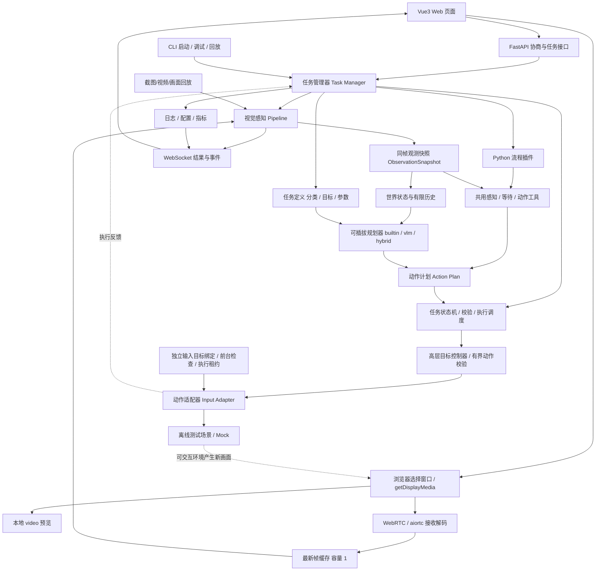

# 冒险岛怀旧服视觉自动化研究工具技术方案

> 版本：v1.31 ｜ 日期：2026-10-28  
> 定位：Windows 本地视觉识别与自动化研究原型，Web 优先；浏览器选择窗口并捕获画面，通过 WebRTC 传给本地 Python 处理，CLI 用于启动、调试与回放。  
> 使用边界：正式服自动刷怪、代练及第三方辅助按键可能违反运营规则并导致封号。本方案重点设计截图分析、状态识别、离线环境任务控制与测试能力；不包含反作弊绕过、输入伪装、行为伪装、虚拟机规避等实现。

## 1. 背景与目标

参考开源项目 [Better Genshin Impact（BetterGI）](https://github.com/babalae/better-genshin-impact)，研究“截图 → 本地视觉识别 → 状态管理 → 决策 → 动作执行 → 结果验证”的闭环架构，将技术思路应用到 2D 横版平台游戏的离线测试与视觉辅助场景。

### 1.1 近期目标（MVP）

- 启动本地服务，在 Web 页面选择共享窗口、预览画面、开始/停止识别并查看状态和日志。
- 使用 `navigator.mediaDevices.getDisplayMedia()` 获取视频轨道，通过 WebRTC 传给本地 Python；首版支持按需保存识别截图，完整录制回放作为后续增量。
- 先限定一个角色、一张地图、固定分辨率与 UI 布局，完成角色和血蓝条识别，输出结构化结果并展示检测框。
- 首版完成一个内置观察任务、最小任务生命周期与暂停/停止；动作计划、Mock 输入和完整交互闭环分阶段验收。
- Web API 与 CLI 共用核心引擎，捕获来源可替换，保留原生截图后端扩展接口。
- 保留任务分类、统一决策接口与最小注册表，首版只提供一个内置观察方案；下一增量接入大模型和 Mock，再扩展混合规划、跑图与战斗任务。
- 原型稳定后打包为可分发的 Windows EXE（优先 onedir），托管前端并启动本地服务。

### 1.2 非目标

- 不以绕过游戏反作弊、伪装人工行为或保证正式服不封号为目标。
- 不修改游戏进程内存、注入 DLL 或修改游戏文件。
- MVP 不实现通用全地图寻路、全自动刷怪、接任务及复杂强化学习系统。
- MVP 不覆盖任意角色、怪物、地图和 UI 样式；怪物、平台及复杂提示识别在基础识别稳定后扩展。
- 不承诺 WebRTC 一定比 Canvas + WebSocket 延迟更低，也不把视频接收帧率作为识别帧率。
- 首版不实现插件市场、运行时安装、任意外部代码加载或热加载；任务分类不代表对应战斗、跑图能力已实现。

## 2. 核心结论与技术选型

推荐 **Python 3.12 + FastAPI/Uvicorn + aiortc（P0 验证）+ OpenCV + Vue3/Vite/TypeScript + ONNX Runtime（可选）+ PyInstaller**。首版即采用 Web 页面和本地服务。

| 层次 | 建议技术 | 选择理由 |
| --- | --- | --- |
| 核心程序/CLI | Python 3.12、Typer 或 argparse | 视觉生态成熟，快速验证，易模块化 |
| 浏览器捕获 | getDisplayMedia + HTML video | 用户通过浏览器选择窗口；本地直接预览视频，无需先用 Canvas 抽帧 |
| 视频传输与接收 | WebRTC + Python aiortc/PyAV | 发送视频轨道，后端接收并解码为图像；P0 验证编解码、Windows 安装与性能 |
| 回放与备用捕获 | 视频/图片回放；可选 mss/dxcam | 回放用于可复现测试；原生捕获作为可替换后端，mss 区域截图需另行定位窗口 |
| 图像处理 | OpenCV、NumPy | 模板匹配、颜色阈值、边缘/轮廓、图像预处理 |
| 目标检测（可选） | ONNX Runtime + 适配的检测模型 | 当模板匹配难以处理角色、怪物多样性时再引入 |
| OCR | RapidOCR ONNX Runtime（姓名读取）；后续扩展文本 | 识别左下角姓名；本地执行，不调用云服务 |
| 任务定义 | 分类、目标、参数 schema、允许动作、验收条件 | 将“做什么”与“如何决策”分开，便于同一任务选择不同规划器 |
| 决策插件 | Python 统一接口 + 显式注册表 | 支持 builtin、vlm、hybrid，声明兼容任务和所需能力；默认使用内置规则 |
| 任务生命周期 | 独立状态机；行为树可后续扩展 | 核心引擎统一管理执行、验证、暂停、取消；流程插件编排工具，决策插件生成计划 |
| 平台路径规划 | 平台图 + A*（后期） | 节点=平台；边=跳跃、下落、梯子等转移 |
| 输入适配 | 可替换接口；后续离线测试使用 Windows 输入 API | 默认观察/Mock；真实输入独立绑定窗口、有界执行，启用前验证停止与故障覆盖 |
| 本地服务 | FastAPI + Uvicorn + WebSocket | HTTP 负责协商与任务接口，WebSocket 推送结果、状态和日志；视频走 WebRTC |
| Web UI | Vue3 + Vite + TypeScript | 首版提供窗口共享入口、预览、识别控制与结果展示 |
| 配置与状态 | YAML/JSON + SQLite（需要历史记录时） | 开始简单，后续便于追踪数据 |
| 打包 | PyInstaller --onedir | 易处理模型文件、DLL 和静态资源 |

**为什么不是一开始使用 Tauri？** 浏览器已经提供共享选择器和视频预览，FastAPI 可直接托管 Vue3 构建产物。先验证浏览器到 Python 的视频链路；只有确定需要原生窗口、托盘、安装体验时再评估 Tauri，并重新验证其 WebView 捕获能力。

**WebRTC 与 Canvas 的取舍：** 主路径直接将视频轨道交给 `RTCPeerConnection`，前端无需将每帧画到 Canvas 后再发送图片。WebRTC 仍有视频编码、接收缓冲和解码开销；同机传输是否优于 Canvas 图片 + WebSocket，取决于分辨率、编码器、CPU/GPU 负载及识别速度。Canvas 图片传输仅作为需要时的对照或备用方案，首版不同时完整实现两套。Canvas 仍可用于检测框绘制或按需截图。

**C# 备选：** 若希望大量复用 BetterGI 的 Windows/C# 底层实现，可考虑 C#/.NET + OpenCvSharp + ONNX Runtime + ASP.NET Core + Vue3。直接移植 BetterGI 的完整业务逻辑并不合适，因为其围绕《原神》的 3D 场景与 UI 设计。复用源码需核查 GPL-3.0 授权条件。

## 3. 总体架构



### 3.1 核心设计原则

1. **感知与决策分离**：OpenCV/ONNX 输出结构化信息，不直接发送键鼠指令。
2. **决策与执行分离**：任务引擎只输出动作意图，交由输入适配器处理。
3. **CLI 与 API 共用核心引擎**：避免把识别循环直接写进 HTTP 请求函数。
4. **支持录制回放**：算法迭代可基于同一段视频/截图复现问题。
5. **默认安全**：默认只读识别、Mock 输入；支持热键/信号紧急停止；输入操作限定授权的离线测试环境。
6. **可观测**：每次识别、状态切换和动作均记录时间戳、置信度及原因。
7. **实时画面优先**：媒体接收和识别独立运行；实时模式只保留最新待识别帧，避免无限排队。
8. **回放与交互测试分开验收**：录制视频和 Mock 验证识别与决策流程；可交互环境验证动作是否改变场景。
9. **任务与决策方式独立**：同一任务可以使用不同规划器，兼容性通过能力声明检查，不假定每种规划器支持所有任务。
10. **插件不直接执行输入**：决策插件返回结构化计划，流程插件通过共用工具提交动作计划，由核心引擎校验和调度；状态机、紧急停止和结果验证不由插件接管。
11. **同帧观测**：画面、检测结果和观测元数据绑定为不可变快照，不拼接不同帧的“最新数据”。
12. **捕获与输入分别绑定**：浏览器选定的共享来源不能直接作为 Windows 输入目标；真实输入需要独立确认目标窗口。

## 4. 主要模块

### 4.1 画面捕获

#### 4.1.1 浏览器捕获与授权

- 用户点击“选择游戏窗口”，调用 `getDisplayMedia({ video: { displaySurface: "window" }, audio: false })`；`displaySurface` 是偏好，最终来源由用户选择，不得假定一定选中了游戏窗口。
- 页面将 `MediaStream` 绑定到本地 `<video>` 预览，并通过 `RTCPeerConnection.addTrack()` 发送视频轨道；无需先经过 Canvas 图片编码。
- 每次新建捕获会话都需要用户授权和点击等瞬时激活，不能按应用名称静默选择窗口或自动恢复共享。
- API 要求安全上下文；本地页面使用 `http://localhost` 或 `http://127.0.0.1`，启动时检测 `isSecureContext` 和 API 是否可用。局域网访问需配置 HTTPS。
- 首版验证 Windows 上指定版本的 Chrome/Edge；记录浏览器、操作系统、游戏显示模式。遮挡、最小化、全屏、DPI 缩放和浏览器后台状态分别测试，不保证持续捕获。
- 监听轨道结束、静音/恢复及实际尺寸变化；更换来源或分辨率后更新尺寸版本、重置受影响状态并重新确认任务。

当前 `web/src/components/ScreenCapture.vue` 已提供本地预览，用户确认宿主机窗口共享可用；拒绝授权和生命周期边界仍需逐项验证。新增 `web/src/media.ts` 在共享后自动建立 sendonly 视频连接，先完成 ICE 收集再发送完整 offer；后端只接收，双方显式设置空 iceServers。失败时保留本地预览供重新连接，停止/离开时关闭 PeerConnection 并尽力 DELETE 会话。不进行识别或连续录制，本次 WebRTC 增量待宿主机验证。

轨道 mute 不是所有冻结的可靠检测；画面尺寸通过视频 metadata/resize 更新，后端解码尺寸另行驱动 size_version。后端无新帧监测按接收时间触发，不能识别“仍收到帧但内容冻结”的所有场景。

#### 4.1.2 后端接收与最新帧缓存

- 使用 aiortc 接收视频，PyAV 解码并转换为识别所需的 BGR/NumPy 图像；编解码格式通过 WebRTC 协商，具体依赖版本在 P0 验证后锁定。
- 统一帧格式：`session_id`、`frame_id`、媒体时间戳（PTS/time_base，可缺失）、后端接收/解码单调时钟、宽高、尺寸版本、图像矩阵、来源。
- 独立接收任务持续消费视频，不在媒体接收协程或 HTTP 请求中执行阻塞识别。耗时识别交给独立工作线程或进程，避免阻塞 asyncio 事件循环。
- 实时模式维护容量为 1 的最新帧缓存，替换尚未处理的旧帧并统计丢弃数；识别完成后取当前最新帧，不追赶历史积压。
- 丢帧发生在解码后的识别调度层，不随意丢弃压缩视频包，以免破坏解码依赖。媒体库内部缓冲也需测量，容量为 1 的应用缓存不代表整个链路没有积压。
- 回放支持按实时速率播放或逐帧完整分析；完整分析模式保留每帧，不能沿用实时丢帧策略。
- 超过配置的无新帧超时、视频轨道结束或连接故障时暂停任务，清理过期帧；重新连接后不自动恢复真实动作任务。

当前 `app/media/service.py` 实现单活动会话与独立接收任务，aiortc/PyAV 解码后逐帧在线程中转换为只读 BGR 数组，`app/media/frames.py` 保留容量为 1 的最新帧。超限尺寸拒绝、尺寸变化清空旧缓存并递增版本。关闭时立即使会话失效并清空缓存，以独立清理任务取消接收/监测并关闭连接；调用方取消不能取消清理。自动识别任务尚未实现；当前手动视频分析 API 已由 EngineService 使用该帧源。

当前配置默认：后端协商 15 秒、首帧等待 15 秒、无新帧 8 秒、控制心跳 10 秒，解码后画面上限 8,294,400 像素；这些是启动保护值，不是已冻结的性能验收门槛。前端约每秒 POST 心跳获取指标，后端监测每 0.5 秒运行；浏览器协商总上限 30 秒、ICE 收集 10 秒、心跳请求 3 秒。当前用 HTTP 心跳代替尚未接入的事件 WebSocket 存活监测，后台计时器节流及最小化行为待实测。协商期间未拿到应答的页面离开，也由协商/连接/心跳超时回收；不依赖页面 DELETE 必达。

#### 4.1.3 性能与时间测量

- 分别记录捕获/发送 FPS（浏览器可观测时）、接收解码 FPS、有效识别 FPS、丢帧数、各阶段耗时及 CPU/GPU 使用率。
- 记录解码完成到识别完成、结果返回和页面展示的 P50/P95 延迟；报告测量起点，不能将后端耗时当作完整端到端延迟。
- 浏览器与 Python 单调时钟起点不同，跨端时间差需通过往返探测估计偏移并报告误差；媒体 PTS 不能直接作为真实采集时间。完整画面产生到结果显示的延迟使用带时码测试场景等方式验证。
- 比较方案时固定画面内容、分辨率、识别模型、硬件与准确率要求，不预先承诺固定延迟或 FPS。提高接收 FPS 不会自动提高模型吞吐量。

当前指标只包含最近约 2 秒的接收 FPS、累计帧数、最新帧年龄、BGR 转换耗时、缓存替换次数和尺寸版本。年龄从 `track.recv()` 返回已解码帧开始，转换耗时不代表视频解码耗时；不宣称已测得完整端到端延迟。缓存替换不是网络丢包，当前无识别消费者时替换次数自然增长。P50/P95、CPU/GPU、媒体内部缓冲与模拟识别压力测试仍未完成。

后端截图从当前会话最新未过期帧编码 PNG，在线程中处理并限制一个在途编码请求；编码结束再次检查会话和尺寸版本，已关闭会话或尺寸变化则拒绝返回。下载包含会话/帧编号，不默认在服务器落盘，不使用浏览器 Canvas 截图代替后端接收验证。

### 4.2 视觉识别

按成本从低到高选择识别方法：

1. **区域分析/图像预处理**：裁剪固定文字区域；首版血蓝与经验只做本地 OCR，不进行色条识别。
2. **OpenCV 模板匹配**：图标/按钮及当前固定外观人物模板，通用人物检测另行验证。
3. **OCR**：当前读取左下角姓名单行；提示文字和任务文本后续扩展。
4. **ONNX 目标检测**：角色、不同怪物、掉落物等复杂目标。

标准化输出示例：

```json
{
  "observation_id": "session-01:1834:profile-hash",
  "session_id": "session-01",
  "frame_id": 1834,
  "source": "webrtc",
  "source_size": [
    1382,
    807
  ],
  "size_version": 1,
  "bbox_format": "xywh",
  "profile_version": "profile-hash",
  "processing_ms": 810.0,
  "player_name": {
    "status": "known",
    "text": "示例角色",
    "raw_text": "示例角色",
    "confidence": 0.95,
    "bbox": [
      114,
      778,
      340,
      17
    ],
    "reason": null,
    "processing_ms": 100.0,
    "backend": "rapidocr-onnxruntime/1.4.4"
  },
  "hp_numbers": {
    "status": "known",
    "text": "2534/3711",
    "raw_text": "2534/3711",
    "confidence": 0.95,
    "bbox": [
      495,
      762,
      142,
      14
    ],
    "reason": null,
    "processing_ms": 100.0,
    "backend": "rapidocr-onnxruntime/1.4.4",
    "current": 2534,
    "total": 3711,
    "ratio": 0.6828
  },
  "mp_numbers": {
    "status": "known",
    "text": "48/513",
    "raw_text": "48/513",
    "confidence": 0.95,
    "bbox": [
      664,
      762,
      141,
      14
    ],
    "reason": null,
    "processing_ms": 100.0,
    "backend": "rapidocr-onnxruntime/1.4.4",
    "current": 48,
    "total": 513,
    "ratio": 0.0936
  },
  "player_level": {
    "status": "known",
    "confidence": 0.95,
    "reason": null,
    "processing_ms": 100.0,
    "backend": "rapidocr-onnxruntime/1.4.4",
    "text": "55",
    "raw_text": "55",
    "bbox": [
      62,
      772,
      28,
      19
    ],
    "value": 55
  },
  "player_job": {
    "status": "known",
    "confidence": 0.95,
    "reason": null,
    "processing_ms": 100.0,
    "backend": "rapidocr-onnxruntime/1.4.4",
    "text": "剑客",
    "raw_text": "剑客",
    "bbox": [
      114,
      763,
      140,
      15
    ]
  },
  "experience": {
    "status": "known",
    "confidence": 0.95,
    "reason": null,
    "processing_ms": 100.0,
    "backend": "rapidocr-onnxruntime/1.4.4",
    "text": "503851[54.37%]",
    "raw_text": "503851[54.37%]",
    "bbox": [
      843,
      762,
      140,
      14
    ],
    "value": 503851,
    "percentage": 54.37
  },
  "scene_name": {
    "status": "found",
    "target_name": "示例角色",
    "name_bbox": [
      650,
      455,
      96,
      16
    ],
    "candidates": [
      {
        "text": "示例角色",
        "confidence": 0.95,
        "bbox": [
          650,
          455,
          96,
          16
        ]
      }
    ],
    "search_bbox": [
      8,
      31,
      1365,
      693
    ],
    "reason": null,
    "text_count": 15,
    "processing_ms": 200.0,
    "backend": "rapidocr-onnxruntime/1.4.4"
  },
  "player_body": {
    "status": "found",
    "bbox": [
      653,
      378,
      71,
      75
    ],
    "bottom_center": [
      688,
      452
    ],
    "search_bbox": [
      588,
      275,
      220,
      180
    ],
    "score": 0.95,
    "candidates": [
      {
        "bbox": [
          653,
          378,
          71,
          75
        ],
        "score": 0.95
      }
    ],
    "template_id": "normal",
    "template_version": "template-hash",
    "reason": null,
    "processing_ms": 5.0,
    "method": "template_matching"
  },
  "dialogue": null,
  "workflow_inspection": null
}
```

以上为当前血蓝及姓名接口格式示例，并非真实运行数据。实际 bbox 必须在对应 source_size 范围内；角色、怪物、scene 及 UI 汇总字段在相应能力落地后扩展，当前不输出虚构检测。confidence 是 OCR 模型分数，不是经过独立测试校准的准确率。

#### 离线图片输入与血蓝调试增量

没有游戏应用时，用户在 Web 的“离线截图”选择 samples 中的 PNG/JPEG，以原始字节上传本地服务。当前最多保留一张标准化截图和一个在途识别；新图替换旧图后旧 ID 失效，离开页面尽力 DELETE，服务退出释放图像。不将上传内容写入 samples，也不允许通过 API 读取任意本地路径。

默认限制上传 10 MiB 和 8,294,400 像素，仅单帧 PNG/JPEG；上传读取超过 15 秒拒绝，解码前检查尺寸、统一 EXIF 朝向并生成同像素预览。图像数组只读，source=screenshot、frame_id=1，源采集时间未知；导入时间不能当作真实游戏观测时效，也不将离线结果用于真实输入。

区域配置放在独立设置页，仅包含 hp_text、mp_text、exp_text、player_info、player_name、player_level、player_job、scene 的 xywh 矩形、scene_exclusions UI 排除区与 OCR 置信度阈值。SVG 框选通过屏幕变换逆矩阵映射源图坐标，支持数字编辑、清空与保存；切换参考尺寸时清空所有区域。识别测试页只读使用保存配置，设置页可试识别草稿；结果绑定实际配置哈希。配置保存到 configs/vision.json，原子替换并同步引擎。按用户要求移除血蓝和经验色条识别及预设框：不提供旧配置兼容或迁移；hp/mp/exp、min_channel/min_color_difference/min_column_fraction/min_continuity 等废弃字段与其他未知字段均由 extra=forbid 拒绝。API 接收含未知字段的配置返回 422，启动加载不合规范文件按现有配置校验报错；不自动清理或转换。仓库默认配置已经仅保留文字区域和 OCR 阈值。

当前仅识别文字：ObservationResult 返回 hp_numbers/mp_numbers、player_name、player_level、player_job、experience、scene_name、player_body，以及可空的 dialogue/workflow_inspection，不再返回 hp/mp 色条结果。原 app/vision/bars.py 和颜色规则测试已移除；页面删除色条框与色条比例。血蓝 ratio 仅来自 current/total，经验 percentage 仅来自画面数字；OCR 失败返回未知，不使用颜色估计兜底。此为用户授权的识别方式调整，未改变正式准确率/FPS/P95 验收门槛，也不宣称 OCR 已通过真实验收。

新增 normal.png 预设区域：player_level=(62, 772, 28, 19)，只框左下角等级数字，避开 LV. 标签；player_job=(114, 763, 140, 15)，覆盖职业文字一行，避开下方姓名；exp_text=(843, 762, 140, 14)，覆盖经验条上方经验数字及括号中的百分比，避开 EXP 标签。三项均为可省略的 Rect 字段，旧配置按 null 读取，支持框选、数字编辑、清空、保存与只读框展示，尺寸切换时与其他区域一并清空。已接入等级/职业/经验数字 OCR，新增 player_level/player_job/experience 结果，右侧显示读取值或未知；预填坐标需宿主机校准，不能当作识别结果。

左下角角色信息栏默认按 normal.png 预填 player_info=(14, 763, 444, 34)，包含等级、职业和姓名；姓名单行区域 player_name=(114, 778, 340, 17)，避开上一行职业和左侧等级。两者使用源帧 xywh 坐标，可重叠，支持框选、数字编辑、清空、保存和识别测试页框展示；字段省略时按 null 读取，边界检查与参考尺寸切换清空行为和其他区域一致。目前已接入本地 OCR，ObservationResult 新增 player_name 姓名读取结果。角色身份由左下角姓名区域自动读取，不要求手动配置角色名称；读取失败返回未知，历史身份如需保留须标注来源时间与有效期。场景角色名匹配已编写，固定外观模板定位已编写，通用身体检测与连续跟踪仍待实现，不能将信息栏位置当作人物位置。预填坐标需宿主机核对。

姓名 OCR 由 app/vision/names.py 的 PlayerNameReader 实现，和血蓝数字一起在 EngineService 的单个后台识别工作中执行，共用一个缓存的本地 OCR 实例；首个有效姓名请求延迟初始化并缓存一个本地 RapidOCR 实例。依赖固定 rapidocr-onnxruntime==1.4.4，使用其随包的中文 PP-OCRv4 检测/识别模型与 ONNX Runtime CPU，关闭方向分类，线程数 2/1，检测最大边长 1536；不从用户参数导入模型路径或调用云端。模型来源、接口和配置见 [RapidOCR v1.4.4 源码](https://github.com/RapidAI/RapidOCR/tree/v1.4.4/python/rapidocr_onnxruntime)，包安装及 Windows 运行库兼容待宿主机验证，真实姓名准确率未验收。

姓名区域按源图坐标裁剪，最多 1,000,000 像素；灰度反色后等比例放大至多 3 倍、尺寸限制 2048×256，再补 8 像素白边，不修改原帧。模型先检测文字块再识别；恰有一个非空文字块且置信度达到 player_name_min_confidence（默认 0.8，开发起点而非冻结验收门槛）时返回 known/text。低置信度返回 unknown/text=null，raw_text 与 confidence 仅供核对；空结果、多文字块、非有限分数、异常输出、区域缺失/尺寸不符及 OCR 失败均返回明确原因，不以旧姓名代替当前读取。姓名原文不写入日志。初始化缺依赖或失败会缓存失败状态，修复后重启后端；血蓝仍可返回。本次未实现跨帧身份历史、人物身体检测、连续跟踪或地图 OCR；错误区域即使只读出一个文字块也可能误认，需人工检查裁剪和独立样本评估。

血蓝数字 OCR 由 app/vision/numbers.py 实现，复用 PlayerNameReader.read_region 的本地预处理/推理和失败处理，不再创建第二个模型。默认按 normal.png 预填 hp_text=(495, 762, 142, 14)、mp_text=(664, 762, 141, 14)，分别覆盖色条上方的当前值/总值，避开 HP/MP 标签；支持设置编辑、保存和框展示，变更尺寸一并清空，旧配置缺字段时返回未知。numbers_min_confidence 默认 0.8，独立于姓名阈值，作为开发起点，真实数字准确率待冻结测试集与验收。

数字 OCR 恰有一个文字块且达到阈值后，按 Unicode NFKC 规范化全角字符并去掉空白，允许匹配的 HP/MP 前缀、成对方括号、整数“当前值/总值”及规范的千分位逗号；必须整串匹配，不将 O/l 等疑似字符强改为数字，也不从颜色比例推算数值。校验 0 ≤ current ≤ total ≤ 9,999,999,999 且 total > 0；格式/范围错误返回 unknown，current/total/ratio 为 null，保留原文和置信度便于核对。读取到 0/正总值是有效零值。hp_numbers/mp_numbers 各包含 status/current/total/ratio、OCR text/raw_text/confidence/bbox/reason/processing_ms/backend；数值比例为 current/total（四位小数），不再输出色条比例。它们与姓名共用同一帧及配置版本；总处理耗时包含姓名/血蓝数字/等级/职业/经验共至多六次 UI OCR、一次场景 OCR，以及所选流程按需读取且唯一对话候选存在时一次对话 OCR。OCR 依赖或模型失败时数值与姓名返回未知，各文字字段独立返回未知，不产生颜色结果。

等级/职业/经验 OCR 由 app/vision/character.py 实现，复用同一个本地 OCR 实例与单后台工作，分别裁剪预设区域；等级采用独立 player_level_min_confidence（默认 0.6），血蓝/经验采用 numbers_min_confidence（默认 0.8），职业与姓名共用 player_name_min_confidence（默认 0.8）。旧配置未配置对应区域则返回未知，不尝试其他区域或加载模型。所有结果都属于同一帧和配置版本，单项格式或推理失败不清空其余结果。继承 OCR 的 status/text/raw_text/confidence/bbox/reason/processing_ms/backend 元数据，等级另含 value，经验另含 value/percentage。

等级阈值独立调整依据：用户报告真实 OCR 原文为 55、置信度 0.678712785243988，原数字阈值 0.8 将其拒绝；用户明确要求等级单独设为 0.6。配置字段可省略，旧配置默认 0.6；设置页可编辑并保存。此调整只改变等级采纳阈值，整数格式/范围校验保留，不改变其他字段阈值或第 9.1 节正式验收门槛，不追认原 0.8 标准通过。新增边界/隔离与保存测试尚待宿主机执行，样本在新阈值下的重新验证及误读率评估未完成。

等级支持整数及可选 LV/LV. 前缀、全角与空白规范化，校验 1–9999，不将疑似字母强改数字。职业须 1–32 字符、包含字母或汉字且无数字或 /%[]()，不作职业枚举校验，乱码或错误裁剪仍可能误读。经验严格整串匹配可选 EXP 前缀与“整数[百分比%]”或“整数(百分比%)”，支持规范千分位/全角字符；经验值 0–9,999,999,999、百分比 0–100。当前两个字段必须同时读出并通过校验，否则该经验结果整体未知；不从百分比反推总经验，经验不通过颜色计算。原始文字、模型置信度和裁剪图在折叠详情显示，姓名/职业与数字阈值可在设置保存；范围为开发保护约束，真实 OCR 性能/准确率仍待独立测试冻结与宿主机验证。

识别测试页姓名裁剪用同一已上传原图和姓名 bbox 的 SVG viewBox 展示，不生成新截图、不另传图片或新增裁剪 API。姓名处理耗时包含首次初始化/预处理/推理；总耗时包含本帧各字段 OCR 读取与解析。所有结果绑定同一 session/frame/source_size/profile_version。浏览器识别请求等待上限 60 秒（其他操作 20 秒）；请求取消或超时不强制终止底层 OCR 线程，工作完成前保持一个在途上限并返回 429，接收任务继续独立运行。底层运行库卡死无法靠此线程机制终止，恢复须重启服务；时限并非真实 OCR 性能验收通过。

normal.png 可见数字对应约 HP 68.3%、MP 9.4%，仅作人工调试参照。当前值、总值与比例都必须来自实际 OCR 读取/解析，不把样本参照写为结果。错误区域或游戏字体仍可能导致误读，真实数据集评估待完成。

截图和视频均调用 EngineService.analyze，在线程中运行同一识别函数，输出与输入只读帧绑定的 ObservationSnapshot。当前只返回本次快照，不维护世界历史或自动观察任务；同一时间只允许一个识别工作，调用取消后后台工作仍受并发限制。视频分析在执行前后检查会话、尺寸和帧龄；当前 UI 默认手动截图分析，尚无连续识别循环。

本增量工程检查标准：合法图像预览/结果同 ID，保存后可读取同配置，旧图与非法/越界输入被拒绝；OCR 数值格式/范围/阈值不符或尺寸不符返回未知，色条字段不在结果/配置中。真实独立数据集、P0 基线及正式 P1 的准确率/FPS/P95 门槛仍待第 9.1 节规定的冻结与验收，不能用单张开发图或合成测试宣布 P1 完成。

- 模型预处理涉及裁剪、缩放或补边时，检测框须映射回源帧坐标；`bbox` 使用源帧像素，格式为 `[x, y, width, height]`。
- 先建立人工标注测试集，覆盖角色动画、遮挡、特效和血蓝条变化；数据按录制会话划分训练/验证/测试集，避免相邻帧造成评估泄漏。
- ONNX Runtime 只负责推理；引入模型时需补充模型来源、训练/标注流程、许可、版本与准确率报告。
- 同时评估原始截图和 WebRTC 解码画面，检测压缩、缩放对小目标、颜色和文字识别的影响。

#### 场景名字定位增量

app/vision/scene.py 使用同一帧已读取且为 known 的左下角 player_name，在配置 scene 范围内检测并读取文字，再用 Unicode NFKC 和去空白后的完整字符串精确匹配，大小写保留；不使用包含匹配/模糊替换，也不默认角色在中心。身份未知时跳过场景推理，不拿旧姓名补齐。场景名字显示在人物下方；当前在整个搜索范围内匹配名字，不按上下方偏移推算人物。后续身体检测应在名字上方寻找并验证关联，不能用固定偏移冒充身体或脚底检测。名字模块只定位名字标签；新增模板模块在其上方搜索相近外观的身体候选，不输出真实脚底/着地、速度或跟踪 ID；名字出现于对话气泡或其他非人物文字中也可能匹配，需要样本评估和后续身体关联。

normal.png 预填 scene=(8, 31, 1365, 693)，覆盖游戏场景、避开底部聊天和状态栏。scene_exclusions 默认三块分别为小地图 (8,31,224,199)、右上任务区 (1170,31,202,67)、右下快捷键区 (1216,644,146,81)。场景范围支持框选/数字编辑/清空/保存；排除区支持数字编辑、添加和删除（最多 16 块）。场景分析还自动屏蔽已配置的角色信息/姓名/等级/职业与血蓝经验数字区域，不搜索固定 UI；排除区可能遮住其后的真实名字，该情况返回未找到，不猜位置。所有矩形按源帧范围校验，更换参考尺寸一并清空。预设为开发起点，UI 位置改变时需校准，未支持自动 UI 定位。

场景 OCR 共用现有本地 CPU 实例和单在途工作，不增加依赖。复制场景图并将排除区置黑，保留其余原色，按最长边至多 1536 等比例缩小后推理；模型返回四点文字框按实际缩放及场景偏移映射回源帧 xywh，并裁剪到搜索范围。检测框只要与排除区相交就过滤，不能把 UI 中的同名文字当候选。场景输入仍受原帧像素上限约束；OCR 结果最多 256 文字块、最多 32 同名候选，超限返回 unknown，不截断后宣称唯一。

scene_name 包含 status、target_name、name_bbox、candidates（text/confidence/bbox）、search_bbox、reason、text_count、processing_ms 与 backend。没有同名候选为 not_found；多候选为 ambiguous（即使其中某个低分也不挑选）；仅一个同名且 confidence ≥ scene_name_min_confidence（默认 0.8，可设置保存）才 found，name_bbox 是名字框。单候选低分、未知身份、场景未配置、尺寸不符、异常框/模型故障等返回 unknown；name_bbox 只有 found 时提供。候选、目标姓名及匹配结果随同一 session/frame/profile 快照返回，不写入日志、不依赖后来的截图。场景低置信度只影响定位，其他 UI OCR 结果仍保留。

识别测试页在原图叠加绿色已确认名字框或橙色候选框，右侧显示“场景名字定位”状态与名字坐标；折叠详情显示文字数量、候选名称/置信度/框和耗时，明确“名字定位”与身体定位的区别。设置页增加搜索范围、排除区和场景名字阈值。当前只手动截图识别，视频 API 复用同一函数但共享页未增加连续调用。新增坐标缩放/UI 排除/重复候选/低分/未知身份/容量/同帧 API 返回值桩测试，真实 OCR 与多人重叠准确率、Windows 性能仍待宿主机及独立样本验证。

#### 名字上方的固定外观人物模板增量

app/vision/body.py 的 BodyLocator 在 scene_name=found 且有唯一名字框时执行，名字未知/歧义时跳过。搜索范围以名字横向中心为基准向上展开，受 scene 和帧边界裁剪；body_search_width 默认 220（32–1024）、body_search_height 默认 180（32–512）。此范围只用于搜索，不作为检测框返回。模板 ID 仅允许 normal 或 null（关闭），不接受任意文件路径。开发参考固定为 samples/normal.png 中 `(653,378,71,75)` 区域，运行时加载并裁剪，缓存只读 BGR 模板和 SHA256 内容版本；原样本尺寸必须为 1382×807。该参考区包含人物外观和少量背景，不含下方名字；修改样本须重启以刷新缓存。本次没有模板上传/自动学习/外观模型训练，不能将运行输入中的任意区域自动当模板或默认具备通用人物识别。

使用 OpenCV TM_CCOEFF_NORMED 灰度模板匹配，搜索原始尺寸、无多尺度/镜像扩展；依赖显式声明 opencv-python>=4.8,<5，方法参考 [OpenCV 模板匹配文档](https://docs.opencv.org/4.x/d4/dc6/tutorial_py_template_matching.html)。默认 body_min_score=0.85，可设置保存，仅为开发保护值，不是准确率。低纹理/模板不可用/依赖缺失/搜索区过小等返回未找到或未知，非有限匹配分忽略。按最高分提取至多 9 个峰值并抑制重叠模板位置；第 9 个有效候选即超限 unknown，不截断后宣称唯一。候选不得与配置 UI 区域相交，且必须与名字横向范围相交；最佳匹配不满足时直接 unknown，不偷偷选择另一目标。多个非重叠高分候选返回 ambiguous；只有一个高分且满足关联约束才 found。动画、换装、背景变化、缩放、遮挡和相似外观可导致漏检/误匹配；同模板重叠人物也可能无法区分。尚未建立独立数据集准确率或闭环验证。

player_body 与名字/UI 同属一个输入帧和配置版本，包含 status、bbox、bottom_center、search_bbox、score、candidates、template_id/version、reason、processing_ms、method=template_matching。bbox 是匹配模板框；bottom_center 由框底中心计算（x+width//2, y+height-1），只是几何锚点，不能当作解剖脚底、着地或所在平台已识别。未确认时 bbox/bottom_center 为 null，候选和搜索区仅供调试。代码继续运行在同一个后台工作中，UI OCR/名字结果不会因模板失败而清空。

识别测试页新增人物模板定位状态和框底中心，原图显示蓝色模板框/蓝点与虚线搜索区，多候选使用橙框；诊断默认折叠，显示分数、模板版本、耗时和限制。设置页提供模板开关、匹配分和搜索宽高，不把运行中的人物位置当作固定 ROI 保存。合成随机模板测试覆盖非固定偏移的位置、空白/不匹配、重复候选、UI 排除、未知名字、缺模板和同帧 API；它们不是游戏识别效果验收。Windows 上更新依赖、pytest/ruff/typecheck 和 normal.png/其他姿态/偏移/遮挡真实截图验收待完成。连续跟踪、通用人物模型和真实脚底/着地仍为后续阶段。

#### 基础识别与可选流程单步判断（2026-10-28）

每次手动分析均由 EngineService 完成基础识别（角色姓名/等级/职业、血蓝/经验文字、场景名字/人物模板），各项未知互不替代。未选择流程时不运行对话 OCR，dialogue 与 workflow_inspection 为 null。选中流程后通过显式注册表校验版本和业务参数，再将同帧基础 ObservationSnapshot 交给该插件的 evaluate(ctx, params)；不新增流程专用页面或中士分支。

[app/vision/dialogue.py](app/vision/dialogue.py) 仅负责共用对话感知：亮色面板定位、可见 NPC、正文/导航按钮/材料选项与置信度/原图框，不再分类中士页面或产生建议。检测图最大 1600×1000，优先对灰度 Canny 边缘以 RETR_LIST 检查嵌套边框（最多处理面积最大的512条轮廓）：四角近似轴对齐且凸、矩形填充≥0.85，并验证正文子区亮色占比≥0.7。矩形宽 ≥画面28%、宽高比1.35–4.5、面积占比2.5%–40%，排除顶部及底部 UI；这些几何范围保持原值。边框直接包含按钮栏，不额外扩底。没有边框候选才用亮色低色差掩膜/9×9闭运算旧路径兜底；同一边框的嵌套笔画以包含率≥0.95去重，独立多个面板仍歧义。唯一候选才 OCR，多候选 ambiguous（最多8个），无候选 not_found；OCR 放大最多2倍且≤1536×1024，最多64文字块/每块256字符，异常坐标/分数/超限 unknown。用户实测图片3返回no_dialogue_panel，旧连通亮色轮廓不能可靠覆盖正文/头像/按钮分隔，已增加上述边框检测；具体漏检轮廓尚无宿主诊断，不能宣称已定位到某一条阈值或已实测修复。新增1–6真实截图的面板几何回归（不调用OCR）、分隔面板/彩色按钮栏和暗色窗口负例，待宿主机执行。该样式与相对布局只针对当前样本风格，待真实截图校准，不承诺通用所有游戏 UI，也不能用无候选证明关闭。

[SnapshotPerception](app/workflows/perception.py) 提供只读、按本次快照惰性缓存的 dialogue()；重复读取不重复 OCR，不跨请求/会话复用。当前可选感知能力为 dialogue_reading/npc_name_reading，未注入鼠标/键盘/执行上下文。基础与流程判断在同一容量为1的后台识别工作中完成，接收不被识别阻塞；识别截止时间60秒只在检查点判定，无法强行中断底层模型/任意阻塞 Python。历史/断点与自动运行仍未实现。

[中士 decide_exchange](app/workflows/builtin/charlie_decision.py) 是唯一的流程阶段/意图判断函数，由 CharlieExchangeWorkflow.evaluate 调用，供测试和未来运行协调复用，不再另写测试专用判断。中士插件内容版本1.3.0，识别可用、执行仍禁用。按正文0.8开发阈值判断介绍/交易/材料/确认/成功提示；材料名称/数量及搜索预算取参数，不写在通用工具/前端。冲突页面、重复目标、低置信度或明确 NPC 不匹配不产生意图。NPC 不可见时保留未知与缺失条件，可展示只读意图但不授予执行许可；没有可信前序状态，不补齐身份。成功页只提议结束对话或等待目标，明确本轮尚未验证关闭。

统一结果 WorkflowInspection 包含插件/版本、observation_id、status、stage_id/stage_label、fields、annotations、intent、missing_conditions、diagnostics 与耗时；字段是字符串/数值/布尔/null（单字符串≤2048字、最多64项），标注最多64个，意图必须引用有效标注且 execution_authorized 恒false。引擎重新校验类型/字段/目标引用、观测/插件归属及框边界；插件异常/超时/不合格返回降为unknown且无意图，保留基础信息。结果不是 ActionPlan，不能直接传给输入层。

识别测试页从 GET /api/workflows 获取流程/版本/参数 schema 和独立的识别/执行可用性；默认“仅基础信息”。常规字符串/数值/布尔/枚举自动表单，其他参数使用 JSON 对象编辑；后端严格校验，不执行插值/脚本。流程结果用通用组件渲染字段、阶段、意图、依据/缺失条件与标注；原文/置信度在诊断展开。上传、切换流程/修改参数/重识别清空旧结果。现有展示契约能表达的新增流程，只新增插件及注册项即可，无需改测试页；新增工具或展示类型仍需相应开发。

现有图片/视频分析 API 接受 {profile, workflow: {plugin_id, plugin_version, params} | null}；仍支持仅传 VisionProfile 的基础识别调用（供已有视频入口/客户端使用，不属于视觉配置兼容）。新结果 workflow_inspection 可空，dialogue 是流程实际读取后的可选感知诊断，不再含 page/suggested_action/target_bbox。阶段与意图移到插件结果，基础模式两者为null。配置字段未变化。

新增/调整通用感知、流程判断与 API 测试，包含参数/能力/版本拒绝、第二种插件不同字段、同帧关联、惰性缓存、缺失身份/歧义/低分、异常隔离、只读上下文和禁止授权。当前仅虚拟机静态检查，宿主机 pytest/ruff/typecheck 与真实 OCR/浏览器验收待完成，待办保持未勾选。未实现插件自动循环、等待/键鼠工具、输入绑定/租约、历史恢复或独立完成验证，不将 page=success 当作运行 succeeded。

#### 初始场景 NPC 标签识别（2026-10-28）

中士插件1.3.0补充初始阶段：仅当对话读取明确返回 not_found/no_dialogue_panel 时，通过只读 perception.npc_name(name) 查询配置的目标 NPC；对话未知、歧义或模型失败不回退为初始场景。该查询复用 scene.py 的 locate_name，同帧画面、VisionProfile.scene 搜索范围、固定UI/scene_exclusions排除、NFKC去空白完整匹配与 scene_name_min_confidence（默认0.8）。配置参数是搜索目标，不作为观测结果；只有唯一高分候选才显示其实际文字和名字框。

SnapshotPerception按规范化目标缓存本帧结果，最多8个不同名字，候选上限32；不继承前帧身份，不依赖左下角角色名成功。未配置scene/尺寸不符/低分返回unknown，无匹配not_found，重复候选ambiguous，不产生交互意图。初始阶段的查找规则不进入前端，新增 npc_name_reading 识别能力与只读协议，不提供输入工具。

名字成功后继续按下节验证外观，只有完整外观确认才进入await_npc_interaction，不再引用名字标签作为点击意图；名字框不是人物框，也不证明可交互。失败时stage_id=search_npc、实际NPC字段为null，诊断显示原因。图1真实OCR仍待宿主机验证；新增初始阶段/低分/重名/无范围/歧义不回退与缓存桩测试，不能替代身体定位或真实交互验收。

#### NPC 外观人物框增量（2026-10-28）

已增加 app/vision/npc_body.py：NpcBodyLocator复用BodyLocator的有界名字关联模板匹配，只覆盖注册中士外观，不能当作通用NPC模型。参考来自samples/tasks/1.png固定素材裁剪(411,408,50,69)，包含帽子到鞋与少量背景，不含名字或气泡；素材尺寸1382×807，按实际模板像素生成SHA256版本。运行时在已确认名字上方200×150范围内搜索，受scene/帧边界和UI排除约束；搜索位置不是输出人物框，输出来自实际相关性匹配。固定开发匹配阈值0.85，与玩家模板开关/阈值独立，不改变既有冻结验收门槛。

只读perception.npc_body(name)复用同帧名字查询并缓存结果，最多沿用8个名字预算；名字未知不加载模板。返回BodyReading的bbox/search_bbox/score/candidates/template_id=npc_charlie/template_version/reason，低纹理/无匹配/多候选/资源或依赖失败不提供确认人物框。模板矩形不是像素分割/精确游戏碰撞箱，动画、遮挡、缩放和背景变化需要真实样本评估，当前不做多尺度或学习。

中士内容版本1.3.0，识别能力新增npc_body_matching。初始阶段名字确认后还需唯一外观匹配：确认时通过标准annotation npc_body返回实际人物框，意图只引用该框；额外字段展示xywh、匹配分和矩形中心候选点。仅名字确认而外观失败时进入locate_npc_body阶段，无点击意图。仍缺点击可用性/距离、关闭、窗口/租约校验，execution_authorized=false，不执行输入。原初始阶段仅名字就提意图的行为被此规则替代。

新增合成偏移/重复候选/空白/名字未知及参考图人物框回归，调整初始阶段测试，均待宿主机运行；模板自匹配不等于泛化识别或真实可点击验收。通用前端无需增加中士专用代码。

#### 4.2.1 观测快照与历史缓冲

识别完成后创建不可变 `ObservationSnapshot`，包含 `observation_id`、会话/帧编号、尺寸版本、源画面引用、同帧检测结果、识别配置版本及时间元数据。图像引用也需只读或拥有独立生命周期，不能复用会被下一帧覆盖的数组。规划请求持有快照直到完成或取消，资源释放后不能留下悬空引用。

世界状态中的速度、方向等估计可以依赖历史，但需记录所用观测 ID、时间区间、置信度和字段有效期；未更新字段保留自己的来源时间，不能因新帧到来统一刷新为“新鲜”。规划器默认接收最新已完成识别的快照及以该快照为基准的派生状态，不另取容量为 1 缓存中的更新画面来拼接旧检测结果。需要纯视觉观测的插件可使用明确类型的无检测快照，不冒充已识别状态。

最新帧缓存负责待识别帧调度；历史缓冲另行保存少量完整观测，按数量、时间窗口和总字节数三重限额淘汰。每次请求固定历史快照列表，按需缩小/压缩图像，限制在途引用的内存；切换会话或尺寸后清理不兼容历史。首版不启用多帧模型输入，历史能力在 P2 按需求加入。

### 4.3 世界状态与任务状态机

- 世界状态保存角色位置、UI 状态、识别可靠性和观测有效期；后续控制阶段扩展方向、速度估计、是否着地、所处平台和怪物候选。
- 避免根据单帧误识别立即执行动作，可加入置信度阈值与连续帧校验。
- 使用显式状态机：`IDLE → OBSERVE → PLAN → EXECUTE（Mock 或真实适配器）→ VERIFY`；验证后按任务条件进入 `OBSERVE/SUCCEEDED/FAILED`，异常进入 `PAUSED/ERROR`，停止进入 `STOPPED`。
- `state/` 保存观测快照、任务进度及执行反馈；`tasks/` 描述目标与验收条件；`planning/` 根据这些输入生成计划。核心状态机负责状态转换，不依赖规划器内部实现。
- 识别失败或状态不一致时转为 `PAUSED/ERROR`，而不是盲目继续发送动作。
- 连续帧校验同时考虑帧间时间，不能将被丢帧后的观测当作固定时间间隔。状态过期、尺寸变化、停止共享、媒体或控制连接断开时暂停决策。
- 录制视频的后续画面不会受 Mock 动作影响，只验证规则输出；完整 `VERIFY` 必须在可响应动作的自建/授权离线环境中根据新画面判断成功或失败。

### 4.4 横版平台寻路（后续）

- 建立平台图：平台作为节点，跳跃/下落/爬梯作为有向连接。
- 路径规划用 A*，动作级控制负责验证跳跃是否成功。
- 注意镜头滚动：屏幕坐标与世界坐标不同，需通过相对地形/小地图锚点进行修正。

### 4.5 动作执行适配

定义统一接口 `execute(action)` 和 `stop()`；P1 只读观察，P2 实现 Mock 动作执行与回放。P3 在获得授权的离线/自建测试环境中实现 Windows 输入适配层。

真实适配器需定义动作 ID、执行回执、超时、取消和执行结果。执行不能阻塞媒体接收；浏览器捕获 API 不提供对外部应用的键鼠控制。插件和控制器使用 4.7 的计划契约，输入适配器仅接受已校验的有界动作。

#### 4.5.1 独立输入目标绑定

- 只读观察和 Mock 不要求输入目标。真实输入启用前，用户在本地窗口列表中单独选择目标，服务端保存窗口句柄、进程 ID、进程身份/创建时间及绑定版本；窗口标题只作显示，不能作为唯一身份。
- 页面并列展示共享预览和输入目标，用户确认二者对应。浏览器捕获不能可靠提供窗口句柄，这项人工确认有明确限制；更换共享来源、重建媒体会话或重新绑定窗口后撤销原关联，真实任务须重新确认。
- 执行前及持续动作期间检查目标仍存在、身份未变化、绑定版本一致、目标处于允许的前台状态。失焦时暂停并取消后续动作，不自动抢夺焦点；恢复焦点后由用户恢复任务。
- 检查与输入发送之间仍有竞争窗口，不能承诺绝对定向输入。缩短动作时长并持续检查；需要更强目标绑定时另行验证目标应用支持的输入方式。

#### 4.5.2 有界动作与故障覆盖

| 故障类型 | 处理与覆盖边界 |
| --- | --- |
| 正常停止、停止共享、连接超时、可捕获异常 | 取消计划/请求，停止调度，尝试释放程序持有的按键；停止入口不等待模型或识别队列 |
| 核心服务崩溃或被强制终止 | P3 真实输入由独立执行进程持有；使用心跳与租约超时，在核心服务失联时停止并尝试释放按键 |
| 执行进程也被强制终止、系统故障或输入 API 失败 | 清理逻辑可能无法执行，不承诺释放全部按键；记录无法覆盖的故障，恢复时检查执行状态 |

真实输入启动前必须验证独立执行进程及租约机制。每个动作规定最大持续时间，执行进程用自己的计时器到期释放，不依赖识别循环结束；心跳仅在任务、观测和输入目标均有效时续租。维护程序持有的按键集合，正常清理只处理该集合。停止、释放与完成回执应可重复处理，反馈区分“已发送”“已结束”和“画面验证成功”。单进程定时器不能覆盖进程被强制终止的情况，独立进程也不能保证所有故障都可恢复。

### 4.6 任务方案与分类

任务方案定义“做什么”，独立于决策插件。每份定义包含：稳定 `task_id`、版本、显示名称、分类、标签、目标、参数 schema、所需感知能力、允许的动作及成功/失败/超时条件。任务可以复用验证器，但不能将验收完全交给生成计划的模型自我判断。

| 分类 | 任务方案示例 | 所需能力与阶段 |
| --- | --- | --- |
| `observation` 观察 | 角色与血蓝监测、等待角色重新出现 | 首版固定场景识别；观察任务输出 ObservePlan，不执行输入 |
| `combat` 战斗 | 固定区域战斗测试 | 后续离线环境，需要目标识别、战斗动作和反馈验证 |
| `navigation` 跑图 | 前往指定位置、到达指定平台 | 后续离线环境，需要位置、地形和移动/跳跃控制器 |
| `quest` NPC 任务 | 接取、对话、材料交付流程 | 后续交互阶段，按流程声明 NPC/对话等感知能力，需要核验任务或库存时再要求对应识别；均需有界输入与独立完成验证，当前未实现 |

分类用于页面筛选；兼容判断以具体任务 ID、参数和能力为准。预留分类和接口不等于已经实现完整打怪或跑图功能。

#### 4.6.1 Python 流程插件（基础 SDK 已编写，运行器待实现）

流程采用 Python 插件调用共用工具，不再使用 JSON 节点图、流程解释器或旧格式迁移器。JSON/YAML 仅保存启动参数和设置。详细入参与出参以 [流程插件接口](docs/workflow-plugin-spec.md) 为准；当前已建立 app/workflows：严格参数/元数据/证据/回执/结果模型、插件与工具 Protocol、显式注册表、协作式上下文及中士插件；只读感知/单步判断与流程列表 API 已接入手动分析，运行器、输入工具和真实兑换未实现，宿主机验证待完成。

流程插件与决策插件职责不同：流程提供 metadata、params_model 和 async run(ctx, params) -> WorkflowResult，编排识别、等待、点击及有界分支/循环；4.7 的决策插件仍通过 plan(context) 返回 ActionPlan。确定性流程不必每步调用规划器；动作工具将请求转成结构化计划，经过共用引擎、控制器和执行层，不能由脚本直接调用系统输入。

metadata 包括 id、api_version、version、task_id、名称/分类/说明/标签、所需能力和允许动作；params_model 为严格校验、冻结的 Pydantic 业务参数模型。启动选择 plugin_id/plugin_version、params、session_id、Mock/真实模式及有界运行/动作预算。引擎提供只读运行上下文 ctx（运行/会话、模式、截止时间、工具门面、checkpoint 和带步骤时限的 set_step），工具返回 ToolResult，包含明确状态、类型化 value、证据引用和可能已经发送输入的回执。最终 WorkflowResult 包含 status/code/message/last_step/data/evidence；成功仍需任务独立验证器检查，不能仅凭脚本返回值提交成功。完整字段、类型、失败语义见接口文档。

引擎负责活动运行时间、步骤时限、动作预算、会话/窗口时效、暂停/停止和结果记录。暂停取消本次协程，不承诺恢复 Python 调用栈或从 last_step 自动续跑；重新启动先读取新画面确认起始条件，结果不明不自动重发。工具的目标引用绑定同帧快照；鼠标/键盘工具不暴露原始输入适配器，组合工具共享预算。可信脚本仍可能阻塞 Python，工具门面不构成沙箱，输入停止依赖共用执行层和租约。

流程插件首个版本仅显式注册随项目发布的可信内置实现，每次运行创建独立实例；稳定接口与内容版本，运行固定有效参数及代码/发布标识。上传、目录扫描、热加载、依赖安装和不可信代码隔离均为后续事项。接口不足可按需求扩展 Python 类型与工具，同时更新版本、调用方、规范和待办；不再要求保留未运行的旧 JSON 设计或开发其迁移兼容。

首个交互流程为 [天空之城中士兑换步骤](workflows/orbis_charlie_exchange/README.md)，对应 samples/tasks/1–6：点击 NPC → 下项 → 同意交易 → 有界滚动选择 100 个僵尸丢失的臼齿 → 确认兑换 → 成功后结束对话。用户提前准备材料与背包空位，不检查库存/空位或复核确认页材料数量；仍识别 NPC、预期页面、选项和成功提示，验证关闭后结束单轮，不自动循环。滚动初值最多 12 次、每次 3 刻度仅限列表区域，受共享时限/预算限制；滚动中间帧、关闭后截图和真实交互待验证。当前保留步骤说明并注册中士占位插件；已编写共用对话感知、插件 evaluate 单步判断及手动识别接入，尚未实现运行/输入工具，不交付可执行兑换逻辑。

当前 create_builtin_registry() 显式注册 implementation_ready=False 的中士插件；describe/validate 按指定 Mock/真实环境检查实现状态、任务/版本、参数和能力/动作，prepare 仅创建新实例与已校验参数，不启动 run。全部能力齐备也不能启用占位实现。RunContext/WorkflowControl 支持协作检查停止、暂停、会话失效与运行/步骤截止时间，同一步骤不延长截止时间，最多 256 个步骤引用；尚无后台取消、动作预算执行、输入解绑/租约、独立验证器或自动运行接入；只读单步判断已接入 EngineService。EvidenceRef 加入 run_id 归属；WorkflowResult 仅校验成功附证据和摘要/引用容量，不代表业务成功。单元测试源码覆盖注册拒绝、实例分离、严格参数、结果不明回执及上下文边界；虚拟机仅做静态检查，宿主机 pytest/ruff 待执行。

不改变 P0/P1 边界：P1 仅内置观察任务；后续 P2 实现流程插件接口/运行器、共用工具和 Mock；真实兑换依赖 P3 输入约束及额外 NPC/对话感知和完成验证，不以截图或 Mock 代替交互验收。

### 4.7 可插拔决策规划器

#### 4.7.1 插件种类与注册

| provider | 职责 | 示例 |
| --- | --- | --- |
| `builtin` | 按固定规则或算法生成计划 | 血蓝监测规则、固定区域规则、后期平台图 A* |
| `vlm` | 根据画面、目标、状态和历史反馈生成结构化计划 | 本地或云端视觉大模型 |
| `hybrid` | 大模型选择目标/步骤，本地算法细化计划 | 模型选择目标平台，本地规划器处理移动与跳跃 |

`provider` 表示决策方式，`strategy` 标识具体插件；模型 `profile` 另行配置，与任务参数分离。内置插件通过显式注册表加载，稳定 ID 唯一，元数据包含接口版本、插件版本、支持任务、所需感知能力、输出计划类型和参数 schema。控制器声明可接收的目标类型、所需能力及可能输出的动作。任务分别限定允许的目标和底层动作；兼容检查必须覆盖插件到控制器再到输入适配器的完整链路，不能只比较插件的动作名称。

首版在启动时注册随程序发布的插件，不从用户配置导入任意 Python 路径。新增插件只需实现统一接口并注册，无需修改 EngineService 的决策分支。支持插件与配置 schema 版本检查；未知 ID、不兼容版本或缺失依赖返回明确原因。

#### 4.7.2 统一接口与数据契约

建议用 Python `Protocol`/抽象类与类型化数据模型定义接口。下列为设计契约，不是已有实现：

| 方法/数据 | 契约 |
| --- | --- |
| `validate(task, config, capabilities)` | 在启动前返回兼容检查结果及可读原因，校验目标、参数、依赖和可用能力 |
| `async plan(context) -> ActionPlan` | 根据绑定画面与检测结果的只读观测快照、有限历史及上一轮反馈生成带判别类型的计划，遵循取消信号和决策截止时间 |
| `async close()` | 释放插件客户端和资源；核心引擎负责终止挂起请求，停止执行不等待模型返回 |
| `PlanningContext` | 包含 run/session ID、配置/输入绑定版本、ObservationSnapshot、相关派生状态、历史快照、任务目标、执行反馈、请求 ID、截止时间及取消信号 |
| `ActionPlan` | 为 ObservePlan / GoalPlan / BoundedActionPlan 的判别联合；公共元数据包含计划 ID、请求与观测引用、运行/配置/尺寸版本和简短说明 |

| 计划类型 | 内容及执行路径 |
| --- | --- |
| `ObservePlan`，`kind: observe` | 无输入动作，表示等待或请求暂停；由状态机按观察任务条件处理 |
| `GoalPlan`，`kind: goal` | 有类型的目标，如到达指定平台，包含坐标系/目标引用、前置条件和目标期限；必须经过匹配控制器 |
| `BoundedActionPlan`，`kind: bounded_actions` | 数量受限的短时动作，如方向键按住一定时间；每步有动作 ID、受限参数与最大时长，由执行层校验并执行 |

高层目标转换前检查目标白名单和控制器能力；转换后再次检查底层动作白名单、总步数、时长、输入目标及取消能力。多步计划不能一次性盲发，每步开始前重新校验。模型不能自行指定任意控制器实现或绕过转换。没有匹配控制器时拒绝启动组合。

字段使用封闭枚举和受限参数，明确屏幕/地图坐标系及目标引用所属地图版本。模型输出必须经过 schema 校验，不能执行其生成的代码、任意脚本或任意工具名。引擎生成/核验公共引用并按宿主配置约束期限，模型不能自行延长有效期。

#### 4.7.3 时间、状态与有效性

- **观测年龄**：使用被引用观测的来源时间计算，不能以请求发送或识别完成时间刷新。若只能取得后端解码时间，指标必须标为“解码后年龄”；采集到解码的延迟另行估计并计入余量，未知时不能将其作为严格的采集时效保证。
- **请求超时**：从请求发起的单调时钟计算，独立于观测年龄；请求未超时不代表计划仍有效。真实输入任务需要已验证的观测时效策略。
- **强制失效条件**：运行实例、会话、配置、画面尺寸/输入绑定或相关地图版本变化，直接拒绝旧计划。
- **状态前置条件**：普通新帧或状态序号增加不自动使计划失效。任务定义角色位置容差、目标是否仍存在、是否着地、场景是否一致等检查；有实质冲突时重新规划。
- **不同计划的期限**：有界动作通常要求短观测年龄，并在每步前校验；高层目标可在目标期限内保持，但控制器必须不断用新观测校验与调整，不能用长期目标授权长期执行旧动作。
- **观测字段有效期**：执行校验用任务依赖字段各自的来源时间，不能只看最新快照时间；时间信息不足或所需字段过期时暂停。

#### 4.7.4 调度、校验与切换

- 每个运行实例至多一个在途决策请求，不按接收视频 FPS 调用规划器；按任务事件、上一步完成或可配置决策间隔触发。
- 核心引擎按 4.7.3 在执行前校验计划结构、允许目标/动作、控制器、当前前置条件及观测时效。已被新请求取代、超时或取消的返回直接丢弃；不能仅因收到新帧就拒绝仍满足条件的高层目标。
- 同一任务的成功条件与反馈格式独立于插件。内置确定性规则可要求回放决策一致；大模型需记录请求、模型/提示版本、参数和原始输出，回归时可回放已记录响应，不承诺重新请求得到相同结果。
- 运行中修改任务或切换规划器须先停止：取消请求、停止动作、清理计划及插件历史、递增运行/配置版本，再检查新组合并启动；MVP 不支持无缝热切换。
- 插件错误、模型超时或输出不合法时默认暂停并说明原因。只有配置了兼容备用插件及明确触发条件，才允许回退，并记录切换事件；不静默改变决策方式。

#### 4.7.5 配置示例

以下为后续离线跑图任务的配置示例；只有任务、地形数据及控制器已实现时才能启动：

```yaml
schema_version: 1
task:
  category: navigation
  id: reach_platform
  params:
    target_platform: platform_b
planner:
  provider: builtin
  strategy: platform_graph
  params: {}
execution:
  adapter: mock
  controller: platform_navigation
```

任务不变，替换 `planner` 并设置宿主执行时效策略即可选择大模型规划；仍需通过兼容检查：

```yaml
planner:
  provider: vlm
  strategy: visual_goal_planner
  profile: local_vision_model
  params:
    request_timeout_ms: 5000
execution:
  adapter: mock
  controller: platform_navigation
  policy:
    max_observation_age_ms: 1000
```

数值仅示意，超时上限与观测时效是不同限制：请求尚未超时也可能已过期。模型 profile 在服务端定义模型、连接地址和凭据引用，密钥不写入任务文件、前端响应或日志。`category` 由任务注册定义校验，不能通过修改分类冒充兼容任务。

## 5. 项目目录

以下为目标目录，按阶段逐步建立。当前已建立 P0 视频链路及离线截图输入、区域配置、基础血蓝/姓名 OCR 识别、独立识别测试页和同帧快照。用户确认首页、窗口共享和后端截图正确；新识别增量与测试待宿主机验证。通用身体检测与连续跟踪、世界状态历史、规划插件、自动任务与输入执行尚未实现，P0 性能/故障和 P1 整体验收未完成。

```text
maple-vision-lab/
├── app/
│   ├── cli.py                  # 本地服务启动、调试、回放入口
│   ├── config.py               # 配置校验及源码资源路径
│   ├── engine.py               # 核心引擎协调器
│   ├── capture/                # WebRTC 帧源 / 视频回放 / 可选原生截图
│   ├── media/                  # aiortc 会话、接收解码、最新帧缓存
│   ├── vision/                 # OpenCV / ONNX / OCR
│   ├── state/                  # 同帧观测快照、有限历史、世界状态、任务生命周期
│   ├── planning/
│   │   ├── base.py             # 统一接口、上下文和计划契约
│   │   ├── registry.py         # 插件注册、元数据、能力查询
│   │   ├── builtin/            # 固定规则与规划算法
│   │   ├── vlm/                # 视觉大模型决策适配
│   │   └── hybrid/             # 大模型与本地规划组合
│   ├── adapters/               # Mock / 离线测试输入适配
│   ├── execution/              # 后续独立执行进程、目标绑定、租约和回执
│   ├── workflows/              # 已编写 SDK/注册/上下文/工具签名/占位；运行器和工具实现待完成
│   ├── tasks/                  # 任务分类、定义、参数和独立验收条件
│   ├── controllers/            # 后续高层意图到有界动作的转换
│   ├── api/                    # FastAPI 协商、控制与事件接口
│   └── utils/                  # 配置、日志、资源路径
├── web/                        # Vue3 + Vite：共享、预览、结果展示
├── models/                     # 本地模型
├── templates/                  # 图标/模板资源
├── configs/                    # YAML/JSON 配置
├── tests/                      # 单测、录制回放测试
├── samples/                    # 测试截图和视频
├── pyproject.toml
└── main.py
```

## 6. Web 页面、媒体会话与 CLI

### 6.1 CLI 命令建议

当前骨架提供 `maple-vision serve [--config PATH] [--host HOST] [--port PORT]` 和版本查询，源码也可通过 `python main.py serve` 启动。下列 detect/replay 命令为后续交付设计，当前不能调用。

```bash
maple-vision detect --source samples/demo.mp4
maple-vision replay --input samples/session-01.mp4
maple-vision serve --host 127.0.0.1 --port 8765
```

CLI 命令、Web API 应共同调用 `EngineService`，不要复制识别、状态机或任务启动逻辑。

用户主入口为本地 Web 页面；P1 提供服务启动和截图样本分析，视频分析/回放命令在 P2 交付。按窗口标题截图命令仅在启用原生捕获适配器后提供。

### 6.2 Web 服务与媒体会话

当前已编写健康/状态、媒体协商/心跳/截图、离线图片导入/分析、区域配置与 `/docs`。未构建前端时根路径返回操作提示，构建并重启后挂载静态资源。任务、规划器、输入绑定、事件 WebSocket 和通用配置更新接口按后续阶段交付。

API 的 capture/vision 表示已提供接收与基础血蓝及姓名 OCR 识别函数，为 true；不代表有有效结果或准确率通过。planning/input 仍为 false。引擎 idle 表示无自动任务，手动识别和 media 接收状态分别管理。

| 接口 | 方法 | 用途 |
| --- | --- | --- |
| `/api/health` | GET | 服务健康检查 |
| `/api/status` | GET | 引擎和当前任务状态 |
| `/api/media/offer` | POST | 接收浏览器 SDP offer，返回 session_id 和 SDP answer |
| `/api/media/{id}` | DELETE | 关闭媒体会话、暂停关联任务并释放资源 |
| `/api/media/{id}/heartbeat` | POST | 续控制存活时间并返回接收指标；关闭状态不再续租 |
| `/api/media/{id}/snapshot` | GET | 下载后端最新有效帧 PNG，关闭/过期时拒绝 |
| `/api/media/{id}/analyze` | POST | 使用请求 profile 分析最新有效视频帧，复用截图识别函数 |
| `/api/images` | POST | 原始 PNG/JPEG 字节上传，返回 image_id 和标准化尺寸 |
| `/api/images/{id}/preview` | GET | 对应图片的标准化 PNG 预览，不缓存 |
| `/api/images/{id}` | DELETE | 释放当前图片；旧 ID 不影响新图 |
| `/api/images/{id}/analyze` | POST | 使用请求 profile 返回该图片的血蓝数值及角色/经验文字同帧快照结果 |
| `/api/vision/profile` | GET/PUT | 获取或原子保存血蓝/经验数字及角色信息/姓名/等级/职业文字区域与阈值配置 |
| `/api/tasks` | GET | 可用任务列表 |
| `/api/planners` | GET | 决策插件元数据、支持任务及当前可用性 |
| `/api/workflows` | GET | 已实现：流程元数据/参数 schema/版本，分别返回识别与执行可用性 |
| `/api/input/targets` | GET | P3 提供可绑定的本地输入窗口及身份信息 |
| `/api/input/binding` | PUT | P3 独立绑定输入目标；关联共享会话并递增绑定版本 |
| `/api/tasks/{id}/validate` | POST | 按 run_kind=planner/workflow 检查任务与参数、决策配置或流程插件、执行能力的兼容性 |
| `/api/tasks/{id}/start` | POST | 接收互斥的 planner 或 workflow 模式配置，重新校验后创建运行实例；流程入参见 4.6.1 |
| `/api/tasks/stop` | POST | 立即停止任务 |
| `/api/config` | GET/PUT | 读取/更新配置 |
| `/ws/events` | WebSocket | 推送日志、状态和识别事件 |

首版限定同机、单个活动媒体会话，浏览器发送视频、后端只接收；初版协商等待 ICE 收集完成后交换完整 SDP，不实现 Trickle ICE。跨网络和 STUN/TURN 不属于 MVP；无法建立本地连接时报告原因，不静默切换到外部中继。

offer 请求包含浏览器预生成的 UUID `session_id`、`type: offer` 和 SDP，应答返回同一 ID；这样协商未完成时也能请求关闭。只接受一个 video m-line，拒绝音频/数据通道；已有活动会话返回 409，不抢占。DELETE 采用幂等语义，不存在或已关闭的 ID 返回 204，旧 ID 不能关闭新会话。服务只保存一个最近关闭状态用于诊断，不保留其画面。新增 PNG 返回 X-Session-Id/X-Frame-Id/X-Size-Version 和禁止缓存标记。

视频通过 WebRTC 的媒体通道传输，不经过普通 HTTP 请求或事件 WebSocket；FastAPI 负责信令和服务管理。设置协商超时和会话空闲清理，覆盖授权拒绝、协商失败、轨道结束、连接断开和页面关闭。后端必须通过连接状态、无新帧超时及控制连接存活检测故障，不能只依赖页面关闭时发送请求。

API 默认监听 `127.0.0.1`，前端由同一本地服务托管；校验 HTTP/ WebSocket 来源，不开放任意跨域访问。捕获授权与动作授权分开处理。局域网访问不属于 MVP，如需开放须增加 HTTPS、鉴权、CSRF/来源检查和访问控制，并重新设计媒体网络配置。

开发模式使用 Vite 7 的 `127.0.0.1:5173`，将 `/api`（后续包括 `/ws`）代理到本地后端；构建产物由 FastAPI 同源托管。当前仅实现 HTTP Host/Origin 检查，WebSocket 来源检查在接口接入时补齐。后端配置保存允许的开发端口；更换端口须同步代理与允许来源。

任务列表返回分类、标签、版本、参数 schema、所需能力和可用状态；插件列表区分“支持此任务”和“当前依赖已就绪”。前端预检查用于提示，启动时后端必须重新校验，不能只依赖页面禁用选项。事件包含运行 ID、任务/插件版本、规划请求、计划摘要、执行反馈及错误原因；模型密钥和完整图片不默认写入日志。

### 6.3 Vue3 页面规划

应用采用顶部标题栏与下方内容区的布局：标题栏显示产品名称，内容区左侧为工作台/识别测试/设置菜单，右侧显示当前页面标题、操作和内容。窄屏缩窄左侧菜单，右侧卡片及操作按钮换行，保持菜单在左侧；具体视觉效果待宿主机验证。

当前页面分为“工作台”“识别测试”和“设置”，使用 /#workspace、/#recognition、/#settings 的 hash 导航，支持直接进入、刷新和浏览器前进/后退，无新增路由依赖。SettingsPage.vue 复用 ScreenshotLab 的 configure 模式提供编辑/试识别/保存，RecognitionTestPage.vue 复用 analyze 模式，上传截图并展示血蓝和姓名 OCR、姓名裁剪、置信度/原因和耗时，只读使用已保存配置，不暴露编辑控件；可选流程按需调用共用感知，结果统一展示，无流程专用前端规则；工作台保留服务状态和窗口共享。模式检查同时限制编辑处理函数；切页卸载当前输入组件，释放截图或共享流，返回后重新选择输入并读取保存配置。

识别测试页以操作和结果为先：页标题下直接显示上传、开始识别和区域设置入口；桌面左侧为游戏截图，右侧固定宽度的信息区，显示角色名称、血量当前值/总值及比例、蓝量当前值/总值及比例和经验值。未识别/识别中/未知状态明确区分，重新识别或替换图片清除旧结果；姓名与血蓝失败原因直接显示。信息区新增等级和职业，并显示 experience 的 OCR 经验值及画面百分比；无法读取时显示未知，不使用预填区域或样本数字冒充结果。裁剪预览、置信度、配置/帧信息及限制放在默认折叠的“识别详情”，窄屏改为单列并优先显示信息区；设置模式保留区域编辑，结果位于编辑区下方。截图组件不再重复显示测试标题和说明段落，实际响应式效果待宿主机确认。

- 共享入口：选择窗口、停止共享、显示当前来源类型、尺寸及连接状态；浏览器共享来源不承诺提供应用进程身份。P3 另加本地输入窗口选择及共享/输入对应确认，显示前台状态和绑定失效原因。
- 仪表盘：接收/识别 FPS、丢帧、处理与展示延迟、任务状态。
- 实时预览：直接显示浏览器捕获的视频，后端只返回检测结果，不默认将视频再次编码传回。
- 预览布局：视频限制在有明确高度的容器内，使用 object-fit: contain 保持画面比例；指标使用可换行网格，卡片与窄屏按钮有最小宽度约束。预览的留黑边需计入后续检测框坐标映射；响应式效果以宿主机浏览器验证为准。
- 检测框叠加：按源画面尺寸、显示缩放及留黑边计算位置；过滤旧会话、旧尺寸和过期结果。后端 `frame_id` 不能直接等同浏览器预览帧编号，实时预览叠加标明结果时效；需要精确逐帧对照时展示对应后端截图/回放，或另行验证媒体时间戳映射，不能宣称仅靠编号即可完全同步。
- 方案选择：按观察/战斗/跑图/任务分类筛选；流程模式选择 Python 插件与参数，规划模式选择内置规则/大模型/混合决策及对应策略，两者启动配置互斥。显示缺失的感知能力、控制器或模型配置；禁用不兼容组合并说明原因。
- 规则与模型配置：识别阈值、任务参数、规划器参数、模型 profile；切换方案先停止任务，界面显示当前生效方案。
- 决策记录：展示计划摘要、采用的插件、执行结果、超时与回退事件，支持相同任务的方案对比。
- 日志与回放：选择历史事件，查看对应截图和决策原因。

## 7. Windows EXE 打包部署

### 7.1 源码开发与共享环境

Codex 在虚拟机编辑共享文件，依赖安装、运行与构建由用户在宿主机执行；虚拟机工具版本不代表宿主机版本。本阶段只做文件级检查，项目运行结论以宿主机反馈为准，避免双方安装程序覆盖共享的虚拟环境和 node_modules。

源码开发建议 Python 3.12，前端 Vite 7 要求 Node.js 20.19+（20.x）或 22.12+；pnpm 版本由宿主机确认。目前依赖加入 aiortc、NumPy、Pillow 和 rapidocr-onnxruntime==1.4.4，PyAV 由 aiortc 引入，ONNX Runtime/OpenCV 由 OCR 包引入。锁定实际依赖版本以宿主机兼容验证为准，运行旧环境需重新 pip install 并重启后端；具体命令见 README.md。

宿主机 VS Code 后端调试入口为 `.vscode/launch.json`，使用 Python Debugger 扩展与项目 `.venv/Scripts/python.exe`，以源码根目录启动 `main.py serve --config configs/default.json`。调试保持单进程，不启用自动重载；前端开发继续使用 Vite 代理，无需先构建。调试启动与断点效果仍需宿主机验证。

### 7.2 EXE 发布（P5）

发布形态为“本地 EXE 服务 + 浏览器页面”。启动 EXE 后托管前端并输出本地地址，可打开默认浏览器；页面仍需用户点击授权共享。CLI 检测/回放继续保留。先在 Windows 验证媒体依赖可安装、可解码，再进行完整打包。

**构建前端并打包静态资源和模型：**

```bash
# 在 web 目录构建 Vue3
pnpm build

# Windows PowerShell 下的 PyInstaller 示例
pyinstaller --onedir --name MapleVisionLab `
  --add-data "web/dist;web/dist" `
  --add-data "models;models" `
  main.py
```

FastAPI 使用 `StaticFiles` 托管前端 `dist`；资源路径应通过 `__file__` / 应用数据目录统一解析，不能假设当前工作目录固定。以上为示意命令，实际使用经过验证的 spec/hooks；aiortc、PyAV 的媒体原生依赖及可选 ONNX Runtime 可能需要额外模块、DLL 或模型资源收集配置。发布构建在 Windows 环境完成。

优先采用 `--onedir`：便于模型更新、排查 DLL 问题，也减少 `--onefile` 启动解包负担。EXE 发布前应在干净 Windows 机器上验证依赖与兼容性。

## 8. AI 模型与大模型的选用

- **默认内置规则，可选择大模型决策**：无需默认部署 LLM/VLM；大模型通过与内置规则相同的规划接口接入，任务和执行层继续复用。
- **视觉输入**：选择同帧观测快照，必要时附带有限历史、任务目标、对应结构化状态与执行反馈；不拼接最新截图和旧识别坐标。纯文本模型只接收结构化信息；直接看图需支持图像输入的模型。WebRTC 视频轨道不能直接当作模型请求，必须转换为目标接口支持的输入格式。
- **本地/云端可配置**：profile 描述模型和端点能力；云端会传出所选画面及上下文，需要用户明确选择启用，默认不上传。模型凭据留在后端；本地模型需实测算力占用和延迟。
- **大模型规划**：适合目标选择、步骤规划和失败恢复；也可在低速离线任务研究直接动作决策，但不得默认认为能满足跳跃时机等高频控制要求。
- **混合方式**：模型选定目标，本地规划器与控制器处理短周期反馈。规则与大模型都必须遵循动作契约、观测时效和取消机制。
- **调用与评估**：限制历史长度、请求频率、并发和可配置调用预算，避免逐帧调用云端模型；记录决策延迟、无效/过期计划比例、任务成功率与费用/资源占用。模型返回期间画面可能变化，执行前必须重新校验。
- **其他可选用途**：自然语言生成任务配置、离线分析错误日志、解释识别结果。
- **强化学习是研究项，而非 MVP 依赖**：可以在自建 2D 模拟环境研究 DQN/PPO，但需要大量训练数据和可控环境。

## 9. 交付计划与验收标准

| 阶段 | 内容 | 验收标准 |
| --- | --- | --- |
| P0 视频链路验证 | Vue3/FastAPI 骨架、窗口共享、本地预览、aiortc 解码、最新帧缓存、基础日志 | Windows 目标浏览器可选窗口并持续接收视频；记录至少 10 分钟运行的 FPS、P50/P95 延迟、资源与丢帧；停止共享/断线/尺寸变化有明确状态和资源清理 |
| P1 首个可交付版本 | 固定场景角色/血蓝识别、同帧快照、一个内置观察任务、最小规划接口/注册表、状态机、WebSocket 结果与按需截图 | 独立测试集通过预先确定的定位/漏检/误检/血蓝误差门槛；画面到结果链路可用，坐标与时效显示正确；任务可启动、暂停、停止；达到冻结的 FPS/延迟要求 |
| P2 可插拔决策增量 | 任务与插件配置选择、Python 流程接口/运行器与共用工具 Mock、大模型适配器、有限历史、录制回放和计划类型 | 同一任务可切换内置和模型方案；不兼容组合被拒绝；同帧输入、超时、前置条件、取消与旧结果处理通过；模型响应可记录回放，未实测模型明确标注 |
| P3 固定场景离线闭环 | 单个移动/跳跃任务、预配置平台图、本地控制器、视觉定位、输入绑定及独立执行租约；按需验证混合规划 | 开始前具备该任务所需最小感知能力；以新画面判断到达/落地，统计重复成功率；失焦、核心进程崩溃与正常停止按故障覆盖表验证；不依赖 P4 的通用平台识别 |
| P4 复杂任务扩展 | 先完成目标/平台感知，再加入限定战斗或更复杂跑图；完善配置与历史 | 识别能力先通过独立数据集，任务再通过交互闭环；比较内置/模型/混合方案的成功率、无效计划、延迟和资源/费用 |
| P5 发布 | PyInstaller、依赖与资源打包、干净 Windows 验证 | 无 Python 环境可打开页面并完成已交付功能；按发布能力检查模型可选依赖和真实输入故障覆盖 |

P0/P1 构成首版范围，大模型、完整回放和动作闭环分别在后续增量交付。目录图是目标结构，P1 不要求预建所有空目录或实现全部未来 API；先完成一个内置观察任务贯通主链路。P0 不要求完整 Canvas 传输对照，WebRTC 未达到需求时再补充同条件测试。

### 9.1 验收门槛冻结时点

- **P0 开始前**：记录测试硬件、Windows/浏览器版本、游戏或测试场景及候选分辨率，确定测量方法与场景集合。
- **P0 结束、P1 开始前**：基于 P0 基线冻结分辨率、最低有效识别 FPS、端到端 P95 延迟上限、无新帧超时、暂停/停止响应目标；冻结 P1 测试集划分、定位误差、漏检/误检及血蓝比例误差阈值。识别目标须依据任务容差和独立开发样本确定，不能看过保留测试集结果后反向降低门槛。
- **P2 开始前**：冻结模型、提示/配置版本、观测时效策略、决策超时和预算、历史容量及无效/过期计划门槛；声明测试是模型实测还是响应回放。
- **P3 开始前**：冻结固定地图与控制参数、位置/着地感知要求、动作时长上限、执行租约、失焦处理、动作验证与重复实验成功率门槛，并明确计入上游延迟的不确定性。
- 门槛、实测结果和版本写入验收记录；未达标则调整实现或缩小任务范围。需要改变门槛时记录理由与新的测试版本，不把修改后的结果当作原标准通过。不预先承诺通用自动化成功率。

P3 固定平台图属于明确配置输入，需说明地图坐标与画面定位方式。自建环境的真值仅用于评估；若决策使用真值，报告须标为“使用真值的控制实验”，不能作为纯视觉闭环成功的证据。

故障测试至少覆盖：拒绝授权、停止共享、页面关闭、WebSocket/媒体断开、无新帧、最小化/遮挡、窗口尺寸变化、浏览器后台、识别耗时超过帧间隔、正常服务退出。P3 增加目标失焦、窗口销毁/身份变化、重新绑定、核心进程被强制终止、租约超时和执行进程被强制终止；按 4.5.2 报告实际覆盖与未覆盖故障，不承诺所有退出路径均可释放按键。

流程插件额外验收参数/工具类型、实例隔离、步骤/动作预算、有界循环、暂停取消与结果不明不重发、独立成功验证；目录加载和上传不纳入首版。插件验收增加：未知/重复插件 ID、接口或配置版本不兼容、缺失感知/控制器能力、非法目标/动作、转换后的越界动作、快照画面与检测错配、历史内存超限、模型不可用、响应超时/过期、取消后迟到返回、任务切换后旧结果、预算耗尽和备用策略触发。验证普通新帧不会错误作废仍有效的目标，而相关前置条件失效会阻止执行。模型真实决策质量须单独评估，桩或响应回放通过不代表模型能力通过。

## 10. 风险、合规与限制

### 10.1 游戏运营规则与账号风险

- 视觉识别在本地完成，并不等于自动游戏操作符合游戏服务条款。
- 第三方辅助按键、自动刷怪、无人值守练级可能被运营方认定为违规；处罚机制和风险概率无法从公开信息准确推导。
- 不应把虚拟机、独立进程、输入方式变化或 AI 决策当作防封方案。
- 客户端检查与服务器行为分析是相互独立的风险来源；未发生即时处罚不代表无风险。
- 若要用于正式运营环境，先向运营方确认允许的功能范围。该技术方案不提供绕过反作弊检测的设计。

### 10.2 工程风险

- 游戏更新会影响 UI、截图位置、素材及识别阈值。
- 窗口分辨率、DPI 缩放、遮挡和最小化影响捕获可靠性。
- 浏览器捕获依赖用户授权和安全上下文，不保证后台、全屏或最小化场景可用；WebRTC 协商和编解码兼容性需在目标版本上验证。
- 视频压缩及缩放可能降低小目标、血蓝颜色和文字识别准确率；提高帧率可能增加编码、解码和识别负载。
- 多帧识别、媒体库缓冲与复杂模型推理可能造成延迟；最新帧缓存只解决识别待处理积压，须记录全链路耗时与有效识别 FPS。
- 本地预览与后端结果存在时间差，检测框可能滞后；尺寸版本、时效过滤和逐帧回放不能省略。
- Windows 模拟输入的响应因软件环境而异，须设置紧急停止和操作边界。
- 浏览器共享来源与本地输入窗口无法仅靠捕获 API 自动可靠关联；真实输入必须独立绑定和确认，失焦暂停仍无法消除检查与发送之间的全部竞争。
- 强制终止执行进程或系统故障可能阻止按键清理；独立执行租约覆盖核心服务失联，不能视为所有故障下的保证。
- 模型文件可能较大，需要管理打包体积和版本。
- 大模型可能误判位置、生成不可达目标或返回不合法计划；接口校验只能保证格式与边界，不能保证任务成功，需要独立反馈验证。
- 模型延迟、服务限流、费用和本地算力影响任务节奏；插件超时、取消、预算及过期结果处理必须独立于媒体接收。
- 插件能力和任务分类可能不匹配；通过注册元数据、启动检查及版本管理避免错误组合，不能把插件化当作任意方案自动兼容。
- 借鉴 BetterGI 源代码时须遵守其 GPL-3.0 许可证；只借鉴理念和架构则需独立实现。

## 11. 参考资料

- BetterGI GitHub：<https://github.com/babalae/better-genshin-impact>
- OpenCV：<https://opencv.org/>
- ONNX Runtime：<https://onnxruntime.ai/>
- FastAPI：<https://fastapi.tiangolo.com/>
- PyInstaller：<https://pyinstaller.org/>
- Vue：<https://vuejs.org/>
- getDisplayMedia：<https://developer.mozilla.org/en-US/docs/Web/API/MediaDevices/getDisplayMedia>
- WebRTC API：<https://developer.mozilla.org/en-US/docs/Web/API/WebRTC_API>
- 安全上下文：<https://developer.mozilla.org/en-US/docs/Web/Security/Defenses/Secure_Contexts>
- aiortc：<https://aiortc.readthedocs.io/en/latest/>
- PyAV：<https://pyav.org/docs/stable/>
- 多模态输入示例：<https://ai.google.dev/gemini-api/docs/video-understanding>
- 模型工具调用示例：<https://ai.google.dev/gemini-api/docs/function-calling>
- Tauri（备选方案）：<https://tauri.app/>

---

**最终建议：** 首版完成“Web 选择窗口 + WebRTC 接收 + 固定场景识别 + 同帧快照 + 一个内置观察任务 + 结果展示”，保留统一规划接口。下一增量接入大模型、有限历史、回放和 Mock，再通过独立输入绑定、有界动作和执行租约验证固定地图的移动/跳跃闭环。目标/平台感知就绪后扩展战斗及复杂跑图；各阶段开始前冻结验收门槛，完成原型验证后发布本地服务与前端。
